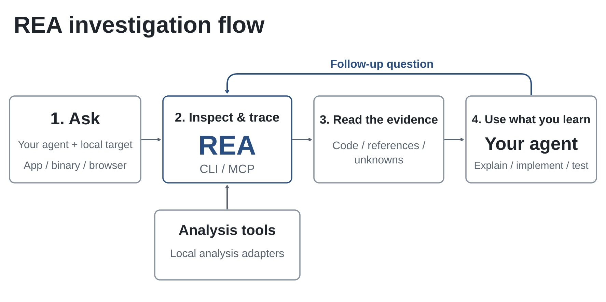

# REA: Reverse Engineer Anything

### One MCP for reverse engineering across binaries, applications, and runtime behavior.

**See a feature you like. Understand how it works, down to the binary level.**

 

 

---

See a feature in an app that you want in your own product? Ask your agent to investigate it with REA. It can inspect the app without its source code, explain how the feature works, show the evidence, and build a version for your project.

REA connects your agent to tools for inspecting native binaries, JavaScript and Electron apps, .NET assemblies, and websites. You can also use the same tools from your terminal. Analysis runs locally, and results include the evidence and limitations behind each conclusion.

Setup registers REA with your agent and installs matching workflow instructions. Native analysis can use an existing Hopper, Ghidra, or IDA installation; setup can optionally install Hopper with approval. Static JavaScript analysis needs no native analysis engine.

## Quick start

### Set up your agent

**Windows Standalone .exe / GUI**
If you prefer not to use Node.js or the terminal, download the standalone `rea.exe` from **[Releases](../../releases)**, place them in the same folder, and **double-click** `rea.exe` to configure REA via a graphical assistant.

Choose your agents, review the proposed changes, and approve them. Setup adds
REA's MCP server and matching workflow instructions, with backups of existing
configuration. Restart your agent afterward.

Setup supports Claude Code, Codex, Cursor, Gemini CLI, Grok Build and
[other agents](docs/installation.md%23supported-agents).

### Update REA

If you use the Windows download the latest `rea.exe` from [Releases](../../releases) and re-run the GUI setup.

## How REA works

Your agent calls REA through MCP to inspect the target and trace relevant code.
REA returns findings with their evidence. The agent uses them to ask follow-up
questions, explain the behavior, or write and test an implementation.
CLI commands use the same workflows.

## What you can analyze

REA requires Node.js 22.x (>=22.19), 24.x (>=24.11), or 26+, plus npm (or Windows standalone `.exe` build where Node.js is not required).
Additional tools and host support depend on the target:

| Target | What REA returns | Requirements and guide |
| --- | --- | --- |
| Native binaries | Pseudocode, assembly, strings, symbols, calls and references | Hopper, Ghidra or IDA; |
| Offline ELF layout | Sections, segments, original symbols/relocations and static mitigation candidates | Caller-supplied pwntools on Linux x64; |
| EVM bytecode | Dispatch selectors, byte offsets, inferred arguments and mutability | Local raw/hex carrier on Linux x64; |
| Recorded Linux crashes | Raw notes, every recorded thread's registers/signals and optional mapping candidates | Caller-supplied pwntools on Linux x64; optional GDB/pwndbg; |
| JavaScript / Electron | Modules, imports, source maps, routes, IPC and native add-on relationships | Node.js and npm (or `rea.exe`); |
| Websites | Page structure, scripts, network observations and requested screenshots | A Chrome-family browser; |
| Saved network captures | Requests, responses, exposed payloads and source locations | HAR; mitmdump on Linux for native mitmproxy captures; |
| .NET assemblies | Metadata, CIL instructions, declared native dependencies and build comparisons | None (static only); |
| Android APKs | Manifest declarations, classes, decompiled methods and references | Headless JADX and a full JDK on Linux/macOS/Windows x64; |
| Firmware | Regions, extraction results and native-analysis handoffs | Binwalk / Unblob on Linux; |
| Packages and resources | File inventories, digests, plists, Apple bundle anatomy and extracted resources | 
| Process behavior | Terminal output, interactions, exit and filesystem observations, and run comparisons | 

Static JavaScript and .NET inspection read the supplied files without running
the application. Runtime capture runs or interacts with the selected target
using your user permissions; each runtime guide describes its effects.

## Showcases

### DX-Ball: reconstruct a sound-pan calculation

Follow a sound call into its position-to-pan helper, inspect the instructions,
and turn incomplete pseudocode into C. The reconstruction passes 3,205
original-x86 cases and reproduces all 63 compiled function bytes.

### Notion: trace the Electron clipboard bridge

Find the renderer's clipboard API, follow it through preload and IPC into the
main process, and inspect the rich clipboard format.

### TH04: recover a DOS bullet-ring calculation

Inspect the original PC-98 game's 16-bit instructions, recover the fixed and
aimed angle calculations, and compare the reconstructed C++ with the
historical compiler output.

## FAQ

Any agent that supports local MCP servers. 
Deep native analysis uses one of them. Static JavaScript and .NET inspection
work without a native analysis engine. Setup can install Hopper after approval;
Ghidra and IDA use your existing installations.

REA starts Hopper when an operation needs it. On macOS, a first-run dialog may
ask you to choose demo mode or activate your license.

The skill supplies investigation instructions for your agent. Use `npx rea-agents setup`
to register REA's MCP server and install the matching instructions, then restart
your agent.

Native analysis returns pseudocode and assembly. JavaScript/Electron analysis
recovers modules and their relationships.

REA analyzes targets locally. Your agent receives the tool results, and its
model provider has its own data policy.

Update first; a recent release may already fix it.

If you are using the Windows standalone version, re-download the latest `rea.exe` and `gui_setup.exe`.
If you're using an agent, complete the setup refresh and restart

## Star history

🎉 **60,000 GitHub stars — thank you!**

<a href="https://www.star-history.com/?repos=morluto%2Frea&amp;type=date">
  <picture>
    <source media="(prefers-color-scheme: dark)" srcset="https://api.star-history.com/chart?repos=morluto/rea&amp;type=date&amp;theme=dark&amp;legend=top-left" />
    <source media="(prefers-color-scheme: light)" srcset="https://api.star-history.com/chart?repos=morluto/rea&amp;type=date" />
    
  </picture>
</a>

Thanks to everyone using REA, reporting bugs, requesting features, testing builds, and contributing fixes.

## Disclaimer

REA provides tools for lawful reverse-engineering research, analysis, and reconstruction. You are responsible for obtaining any required authorization and complying with applicable laws. The project does not endorse illegal or unauthorized use.

REA is an open-source software project. We have not issued or endorsed any cryptocurrency or token. Tokens using the REA name are not affiliated with the project.

## License

[MIT](LICENSE)
